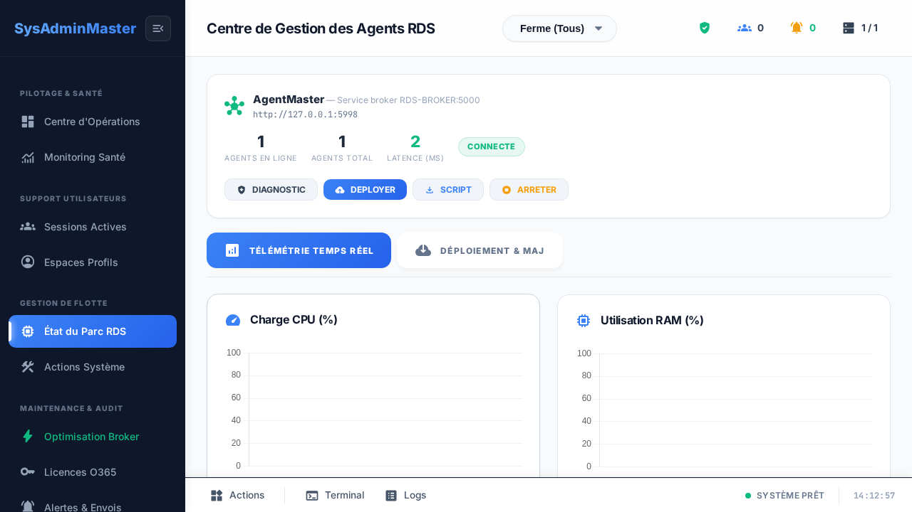

# SysAdminMaster

**Agent-based monitoring and day-to-day administration for Windows Remote Desktop Services (RDS) farms — without WinRM.**

[](.github/workflows/test.yml)
[](LICENSE)


[Lire en français](README.fr.md)

SysAdminMaster gives a small IT team one place to see and act on an RDS farm: live sessions, CPU / RAM /
committed memory, disks, services, user profiles, and the health of Microsoft 365 (Office) licence tokens on
every session host. A lightweight PowerShell agent runs as `SYSTEM` on each host, **pushes** its telemetry over
HTTP and **pulls** the commands queued for it. No inbound port, no WinRM, no domain admin credential stored on
the server.



> **Status:** used in production on a 10-host farm since mid-2026. The web interface is in **French**;
> contributions to make it translatable are welcome (see the [roadmap](#roadmap)).

---

## Contents

- [Features](#features)
- [How it works](#how-it-works)
- [Quick start](#quick-start)
- [Documentation](#documentation)
- [Project layout](#project-layout)
- [Roadmap](#roadmap)
- [Contributing](#contributing)
- [Security](#security)
- [License](#license)

## Features

| Area | What you get |
|---|---|
| **Fleet** | Every host's status (online / busy / silent), agent version, uptime, CPU, RAM, committed memory, disks, Windows services, top processes. Remote agent update in waves. |
| **Sessions** | Active and disconnected sessions per host, per-user load (CPU, memory, processes), targeted message, log off, disconnect, shadow and screenshot requests. |
| **User profiles** | Size of every profile on the profile disk, per-folder analysis, *simulated* then real clean-up of old downloads, with a detailed preview of what would be deleted. |
| **Microsoft 365 licences** | Age of the Office licence token of each user on each host, Shared Computer Activation status, scope by AD OU, two named repair actions (licence cache, identity cache) and a read-only diagnosis of the AAD broker log. |
| **Alerts** | A daily check of stale Office tokens, sent by e-mail (Mailjet), with a full history of every check and its delivery status. |
| **Maintenance tools** | Temp clean-up, RAM trim, print spooler restart, DNS flush, RDS diagnosis and security audit — each one an explicit, allow-listed agent action. |
| **Read-only API** | A separate *read-only* token for dashboards and monitoring tools: it can read agents, history, licences and alerts, and is refused on every command. |

## How it works

```
 Session hosts (Windows, PowerShell 5.1)                Linux server (Python 3)
 ┌──────────────────────────────┐   POST telemetry   ┌──────────────────────────────┐
 │ SysAdminMaster-Agent.ps1     │ ─────────────────▶ │ AgentMaster   :5000          │
 │ scheduled task, SYSTEM       │   every ~10 s      │  ingestion + command queue   │
 │                              │ ◀───────────────── │  SQLite (agentmaster.db)     │
 └──────────────────────────────┘  queued commands   └──────────────┬───────────────┘
        X-Agent-Token                 in the reply                  │ X-Master-Token
                                                                    ▼
                                                     ┌──────────────────────────────┐
                                     browser ──────▶ │ Dashboard     :5050          │
                                                     │  Flask + Socket.IO           │
                                                     └──────────────────────────────┘
```

- **Pull model.** The server never opens a connection to a host. An agent that cannot reach the server simply
  retries; a command waits in the queue until the next heartbeat (and expires after 48 h).
- **Two services.** `AgentMaster` (ingestion, queue, API) and the `Dashboard` (web UI) run as two processes and
  share nothing but the AgentMaster API.
- **Allow-listed actions.** The dashboard only queues actions from an explicit list; the agent only executes the
  actions it implements. Destructive actions always offer a preview first.
- **Fail-closed configuration.** No token, no start: the services refuse to run without their secrets.

Read more in [docs/architecture.md](docs/architecture.md) and the [architecture decision records](docs/architecture/).

## Quick start

Requirements: a Linux host with **Python 3.11+**, Windows session hosts with **PowerShell 5.1** and HTTP access
to the Linux host on TCP 5000.

```bash
git clone https://github.com/lugio/sysadminmaster.git
cd sysadminmaster
python3 -m venv .venv-linux
./.venv-linux/bin/pip install -r requirements.txt

cp .env.example .env              # then fill in the tokens and the admin password
chmod 600 .env
./start-linux.sh                  # AgentMaster on :5000, dashboard on :5050
```

Then install the agent on each session host (elevated PowerShell):

```powershell
.\Scripts\Install-SysAdminMaster-Agent.ps1 `
    -BrokerUrl "http://sam-master:5000/api/agent/metrics" `
    -Token "<value of SAM_AGENT_TOKEN>"
```

Open `http://<server>:5050`, sign in with `SAM_ADMIN_PASSWORD`, and the host appears on the **Agents** page
within a few seconds. The full procedure — systemd units, reverse proxy, firewall — is in
[docs/installation.md](docs/installation.md).

## Documentation

| Guide | For |
|---|---|
| [Installation](docs/installation.md) | Server, systemd services, reverse proxy, first agent |
| [Configuration](docs/configuration.md) | Every environment variable and `config.json` key |
| [Agents](docs/agents.md) | Deploying, updating and troubleshooting the PowerShell agent |
| [API](docs/api.md) | AgentMaster endpoints and the three tokens |
| [Security model](docs/security-model.md) | Tokens, network exposure, what each component can do |
| [Testing](docs/testing.md) | Unit test, static checks, the production-safe end-to-end suite |
| [Architecture](docs/architecture.md) and [ADRs](docs/architecture/) | Why it is built this way |
| [Changelog](CHANGELOG.md) | What changed, release by release |

## Project layout

```
.
├── AgentMaster/          Ingestion service (:5000) — heartbeats, command queue, licences, alerts
├── Web/                  Dashboard (:5050) — Flask app, routes, templates, static files
│   ├── core/             Settings, AgentMaster client, licence scope, auth
│   ├── routes/           Pages, read API, actions
│   └── templates/        Jinja templates (one page per screen, plus a living /styleguide)
├── Scripts/              PowerShell agent, installer, bootstrap and optional relay
├── Config/               config.example.json (the real config.json is git-ignored)
├── deploy/systemd/       Example systemd units
├── docs/                 Guides and architecture decision records
├── e2e/                  Playwright scripts with a network-level read-only guard
├── tests/                Python tests
└── tools/                Static checks used by CI and the pre-push hook
```

## Roadmap

- Translatable interface (the UI strings are French today).
- Single sign-on (OIDC) in front of the dashboard, replacing the shared admin password.
- Packaging: a container image for the server and a signed agent installer.
- A `pytest` suite for the AgentMaster API, next to the existing end-to-end scripts.

Ideas and feedback are welcome in [Discussions](https://github.com/lugio/sysadminmaster/discussions) or as a
[feature request](https://github.com/lugio/sysadminmaster/issues/new/choose).

## Contributing

Contributions of all sizes are welcome — bug reports, documentation, translations, code. Please read
[CONTRIBUTING.md](CONTRIBUTING.md) first, and note that the project follows a
[Code of Conduct](CODE_OF_CONDUCT.md).

## Security

SysAdminMaster can act on production servers. Please **do not open a public issue** for a vulnerability: follow
[SECURITY.md](SECURITY.md) to report it privately.

## License

[MIT](LICENSE) © The SysAdminMaster contributors.
